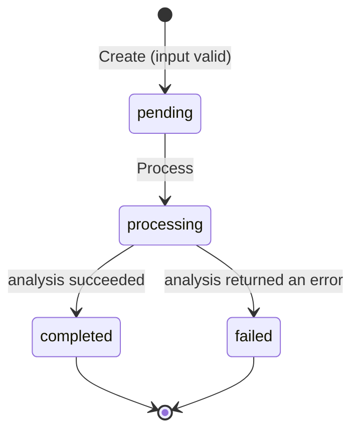

# SIS Checkpoint 1 — Text Analyzer

A small, synchronous, in-memory Go application. You give it a piece of text and it computes statistics about it: word count, unique words, sentences, average word length and the most frequent words.

The work is modeled as **tasks**. Each task has a unique ID, an input text, a lifecycle state and, once processed, a result. Tasks are validated when created, stored in memory, processed on request, and protected by a state machine that rejects invalid operations.

Built for the KBTU *Golang Fall 2026* SIS project, Checkpoint 1 (Core Go).

## Requirements

- Go **1.27** or newer
- No external dependencies, databases or services. Only the standard library is used.

## How to run

```sh
# Analyze one or more texts; each argument becomes a separate task
go run ./cmd/textanalyzer "Hello world. Hello Go!" "Привет, мир! Привет."

# Analyze standard input as a single task
echo "Go is simple. Go is fast! Is it fun? Yes." | go run ./cmd/textanalyzer -top 3

# Also try to process each completed task a second time (shows lifecycle enforcement)
go run ./cmd/textanalyzer -reprocess "Process me once."
```

Flags:

| Flag         | Default | Meaning                                                     |
|--------------|---------|-------------------------------------------------------------|
| `-top N`     | 5       | how many most frequent words to show (must be ≥ 1)          |
| `-reprocess` | false   | try to process completed tasks again and print the rejection |

Example output:

```text
$ go run ./cmd/textanalyzer -reprocess "Hello world. Hello Go!" "   "
input #2 rejected: create task: input is empty
task-1 [completed]
  input:        "Hello world. Hello Go!"
  characters:   22
  words:        4 (unique: 3)
  sentences:    2
  avg word len: 4.25
  top words:    hello (2), go (1), world (1)
  reprocess:    rejected (process task task-1: invalid state transition: completed -> processing)
```

The exit code is `0` if every input was analyzed, `1` if any input was rejected or failed, and `2` for invalid flags.

## How to test

```sh
gofmt -l .        # prints nothing when all files are formatted
go vet ./...
go test ./...
go test -v ./...  # verbose, lists every test case
```

## The task

| Field    | Type               | Description                                             |
|----------|--------------------|---------------------------------------------------------|
| `ID`     | `task.ID`          | unique, sequential ID: `task-1`, `task-2`, …            |
| `Input`  | `string`           | the text to analyze                                     |
| `State`  | `task.State`       | current lifecycle state                                 |
| `Result` | `*analyzer.Result` | analysis result; `nil` until the task is completed      |
| `Err`    | `string`           | failure reason; set only when the task is `failed`      |

### Result

| Field           | Meaning                                                                       |
|-----------------|-------------------------------------------------------------------------------|
| `Characters`    | number of Unicode characters (runes), including spaces and punctuation         |
| `Words`         | number of words                                                               |
| `UniqueWords`   | number of distinct words (case-insensitive)                                   |
| `Sentences`     | number of sentences                                                           |
| `AvgWordLength` | average word length in characters, rounded to 2 decimal places                |
| `TopWords`      | the N most frequent words, sorted by count (desc), then alphabetically (asc)  |

Text processing rules:

- A **word** is a run of Unicode letters and digits, so Cyrillic and Kazakh text works. Apostrophes inside a word (`don't`, `don’t`) and decimal separators inside a number (`3.14`, `1,000`) stay part of the word. Words are compared case-insensitively.
- A **sentence** is a run of text that contains at least one word and ends with `.`, `!`, `?`, `…` or the end of the text. Repeated terminators (`?!`, `...`) end only one sentence, and the dot in `3.14` does not end a sentence.
- Ties in `TopWords` are broken alphabetically, so the result is fully **deterministic**.

### Validation rules

A task is created only if its input passes all of these checks. Otherwise `Create` returns an error and nothing is stored.

| Rule                                   | Error                      | Why                                    |
|----------------------------------------|----------------------------|----------------------------------------|
| Input must be valid UTF-8              | `analyzer.ErrInvalidUTF8`  | the analyzer works with Unicode text   |
| Input must not be empty or only spaces | `analyzer.ErrEmptyInput`   | there is nothing to analyze            |
| At most 10 000 characters              | `analyzer.ErrInputTooLong` | keeps processing of one task bounded   |
| Must contain at least one word         | `analyzer.ErrNoWords`      | `"!!! ..."` has no words, so word statistics are meaningless |

## Task lifecycle



| State        | Meaning                                  | Allowed next states        |
|--------------|------------------------------------------|----------------------------|
| `pending`    | created and validated, not yet processed | `processing`               |
| `processing` | being analyzed                           | `completed`, `failed`      |
| `completed`  | analyzed successfully, `Result` is set   | none (terminal)            |
| `failed`     | analysis failed, `Err` is set            | none (terminal)            |

Any other transition is rejected with a `*task.TransitionError`, which wraps `task.ErrInvalidTransition`, and the task stays unchanged. In particular, **processing a completed task again is invalid**. Analysis is deterministic, so reprocessing could never produce a different result. The transition table is in [internal/task/task.go](internal/task/task.go).

With the real analyzer, input that passed validation never fails, so `failed` is reached only when a `Processor` returns an error. The tests demonstrate this with a fake processor. The state exists so future processors (for example, with timeouts or cancellation) have a place to report failure.

## Project structure

```text
.
├── cmd/textanalyzer/        CLI entry point (flags, stdin, printing)
│   └── main.go
├── internal/
│   ├── analyzer/            domain logic: validation + text statistics (pure functions)
│   ├── task/                Task model, State, lifecycle transitions, domain errors
│   ├── store/               in-memory repository (map + insertion order)
│   └── service/             use cases: Create / Get / List / Process; defines interfaces
├── go.mod
└── README.md
```

Dependencies point inward: `cmd → service → (task, analyzer)`, and `store → task`. The `service` package depends on interfaces, not on `store` directly.

## Design decisions

- **Interfaces at the consumer side.** `service` defines the two interfaces it needs:
  - `Processor` (`Validate`, `Process`) is implemented by `analyzer.TextAnalyzer`. Tests swap in a failing processor to reach the `failed` state.
  - `Repository` (`Save`, `Get`, `List`) is implemented by `store.MemoryStore`. A database-backed or concurrency-safe store can replace it without changing `service`.
  - Compile-time checks in [main.go](cmd/textanalyzer/main.go) (`var _ service.Processor = analyzer.TextAnalyzer{}`) make the build fail if an implementation stops matching its interface.
- **Value semantics for stored data.** The store keeps `task.Task` **values** in a `map[task.ID]task.Task` and returns **deep copies** (`Task.Clone`, `Result.Clone`). Copying a struct copies only the slice header, so `Result.TopWords` would still share its backing array; `Clone` copies the slice too. Code outside the store therefore can't change a stored task, or bypass the state machine, without calling `Save`.
- **Comparing results.** `Result` can't be compared with `==` because it contains a slice. `Result.Equal` compares the fields and uses `slices.Equal` for `TopWords` (`WordFreq` itself is comparable). `Task` *is* comparable, but `==` compares the `Result` pointers, not the results.
- **One receiver kind per type** (Go FAQ consistency rule).
  - Pointer receivers for types with state that changes: all `Task` methods (`TransitionTo`, `Complete`, `Fail`, `Clone`), `*MemoryStore`, `*Service` and `*TransitionError`.
  - Value receivers for small, read-only types: `State` (an `int`), `Result`, and `TextAnalyzer` (configuration only).
  - Because `Clone` has a pointer receiver and map elements are not addressable, `MemoryStore.List` copies `s.tasks[id]` into a variable before calling `Clone`.
- **The state machine is data.** Allowed transitions are a `map[State][]State`, and every state change goes through `TransitionTo`. `Complete` and `Fail` cannot skip the `processing` step.
- **Errors, not panics.** All expected problems are returned as errors: sentinel errors (`ErrEmptyInput`, `task.ErrNotFound`, `task.ErrInvalidTransition`, …) and one typed error (`*task.TransitionError`). Errors are wrapped with context using `fmt.Errorf("...: %w", err)`, so callers can check them with `errors.Is` / `errors.As`. The code never calls `panic`.
- **Deterministic processing.** No randomness, time or map-iteration order affects the result.

## Requirement → implementation / test mapping

| Spec requirement                    | Where                                                                                     |
|-------------------------------------|-------------------------------------------------------------------------------------------|
| Successful creation                 | `TestCreate_Success` ([service_test.go](internal/service/service_test.go))                  |
| Invalid input (table-driven)        | `TestCreate_InvalidInput`; also `TestValidate` ([analyzer_test.go](internal/analyzer/analyzer_test.go)) |
| Successful retrieval                | `TestGet_Success`                                                                         |
| Nonexistent task                    | `TestGet_NotFound`, `TestProcess_NotFound`                                                |
| Successful processing               | `TestProcess_Success`                                                                     |
| Result correctness                  | `TestProcess_Success`, table-driven `TestProcess` in analyzer                             |
| Correct state after processing      | `TestProcess_Success`                                                                     |
| Invalid operation / transition      | `TestProcess_AlreadyCompleted`, `TestProcess_ProcessorError_SetsFailed`, `TestTransitionTo` (all 16 state pairs) |
| Multiple independent tasks          | `TestMultipleTasks_Independent`, `TestStore_ReturnsCopies`                                |
| Structs, methods, interfaces        | `task.Task`, `analyzer.TextAnalyzer`, `store.MemoryStore`, `service.Processor` / `Repository` |
| Slices and maps                     | `[]WordFreq`, word-frequency `map[string]int`, `map[task.ID]task.Task`, transition map     |

## Out of scope for Checkpoint 1

Following the spec, the application is synchronous and in-memory. There is no concurrency, HTTP API, database or external service. `MemoryStore` is not safe for concurrent use. The `Repository` and `Processor` interfaces are where those features will plug in at later checkpoints.
